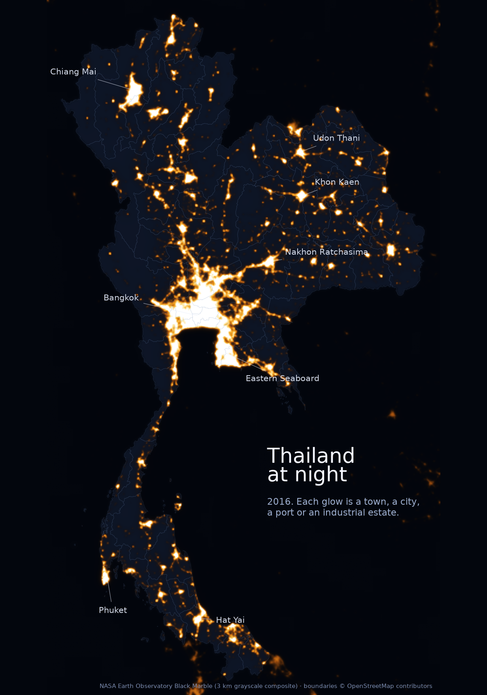

<p align="center"></p>

<h1 align="center">thainowcast</h1>

[](https://github.com/thanatchon36/thainowcast/actions/workflows/ci.yml)
[](pyproject.toml)
[](paper/paper.pdf)
[](docs/data_sources.md)
[](LICENSE)

📄 **[Download the PDF](paper/paper.pdf)** ·
📊 **[Dashboard](dashboard/index.html)** ·
🗂️ **[Data sources](docs/data_sources.md)** ·
🎤 **[Pitch outline](pitch/pitch_outline.md)**

**Pseudo-real-time nowcasting of Thai GDP growth and headline inflation from official monthly statistics and
alternative data** (Google Trends, nighttime lights, Sentinel-5P NO2, online prices, mobility). The pipeline runs a
model race, evaluates it by regime, attaches conformal intervals, ablates each alternative data family and
decomposes every revision into news with a Kalman filter.


> **Synthetic data notice.** The environment this repository was built in has no access to the
> Thai statistical agencies, so `data/raw/` contains `synthetic_*.csv` test files. The loader uses
> them only when a real file is missing and prints a warning every time. Nothing computed from
> them says anything about the Thai economy. `docs/data_sources.md` is the shopping list for the
> real files; drop them in and run `make all`.

## Install and quickstart

```bash
make setup      # uv venv + dependencies (Python 3.12)
make all        # data -> eval -> live -> dashboard -> paper   (about 8 minutes)
make test       # 27 tests, including the leakage test
make app        # Streamlit dashboard (optional: uv pip install -e ".[app]")
```

Outputs: `data/processed/` (backtest table, summaries, DM tests, coverage, ablations, live
nowcast JSON, news), `paper/tables/` and `paper/figures/` (generated), `dashboard/index.html`
(self-contained), `paper/paper.pdf`.

| Target | Purpose |
|---|---|
| `data` | Load real CSVs from `data/raw/`; falls back to `synthetic_*` files with loud warnings |
| `synthetic` | (Re)generate synthetic test data. Never a substitute for real data |
| `eval` | Pseudo-real-time backtest, metrics, DM tests, ablations, tables, figures |
| `live` | Nowcast the current quarter / month as of `ASOF` |
| `dashboard` | Static HTML dashboard → `dashboard/index.html` |
| `geo` | Map and nighttime-lights figures for paper §3.3 (downloads NASA Black Marble + geoBoundaries, ~15 MB) |
| `paper` | Build `paper/paper.tex` and `paper/paper.pdf` (pandoc + tectonic) |
| `arxiv` | arXiv source bundle → `paper/arxiv.tar.gz` (prints title, abstract and comments for the form) |

## What the pipeline does

1. **Registry and release calendar** (`config/indicators.yaml`): 26 series with agency, start,
   publication lag, transform and how to fetch. Lags are approximations — replace with real
   release dates before a real evaluation.
2. **Information sets** (`thainowcast.data.panel`): every observation is stored with its
   publication date; models only ever see `release <= origin`. `tests/test_leakage.py` samples
   random origins and fails if anything from the future gets through.
3. **Ragged edge** (`thainowcast.features.align`): AR(1) completion of trailing gaps (max six
   months), quarterly aggregation, a history-for-breadth rule that admits short series only once
   they have 24 quarters / 48 months of history (the DFM needs no such rule).
4. **Models** (`thainowcast.models`): random walk, AR(p), factor bridge equation, MIDAS
   (exponential Almon, re-estimated per horizon), mixed-frequency dynamic factor model (statsmodels
   `DynamicFactorMQ`, EM, annual refit + re-smoothing), elastic net, LightGBM.
5. **Evaluation** (`thainowcast.eval`): expanding-window backtest from 2015 at origins M1/M2/M3/PR
   (GDP) and M0/PR (CPI), where PR is the day before the official release; RMSFE and MAE by regime
   (pre-COVID / COVID / post-COVID); Diebold-Mariano with HLN correction; conformal 80% intervals
   from already-published errors; ablation per alternative data family.
6. **Live nowcast and news** (`thainowcast.eval.live`): nowcast of the first unpublished
   quarter/month, evolution across origins, and the statsmodels news decomposition of the DFM
   revision between two origins.
7. **Deliverables**: static HTML dashboard, Streamlit app, and the working paper built by pandoc +
   xelatex from `paper/paper.md`, where every table, figure and in-text number is a placeholder
   filled from `data/processed/`.

## Research: *ThaiNowcast: Pseudo-Real-Time Nowcasting of Thai GDP and Inflation with Official and Alternative Data*

The working paper by Thanatchon Chongmankhong is in [`paper/`](paper/): a PDF in [`paper/paper.pdf`](paper/paper.pdf)
and its source in [`paper/paper.md`](paper/paper.md), which pandoc turns into the LaTeX file `paper/paper.tex` (arXiv layout,
[`paper/template.tex`](paper/template.tex)). `make arxiv` packs that file with its figures into `paper/arxiv.tar.gz`
and checks the bundle compiles on its own. The paper asks whether alternative data improve Thai nowcasts over what official
monthly statistics already deliver, and when. Every table, figure and in-text number is generated from
`data/processed/`, so `make all` on the real files replaces them all.

- Tables: [`paper/tables/`](paper/tables/) · Figures: [`paper/figures/`](paper/figures/)
- Section 3.3 shows Thailand at night from the NASA Black Marble composites (real data, built by `make geo`):

<p align="center"></p>
- Pitch (3 minutes): [`pitch/pitch_outline.md`](pitch/pitch_outline.md)

## Repository layout

```
config/indicators.yaml      registry + release calendar
src/thainowcast/
  config.py                 paths and registry loader
  data/                     calendar, panel (information sets), loaders, synthetic generator
  features/                 transforms, ragged-edge completion, aggregation
  models/                   base, design, benchmarks, bridge, midas, dfm, ml
  eval/                     backtest, metrics, dm, plots, report, live (news)
  dashboard/static.py       self-contained HTML dashboard
  paper_build.py            placeholder filling + pandoc -> paper.tex + tectonic
  cli.py                    python -m thainowcast.cli {synthetic,data,eval,live,dashboard,paper}
app/streamlit_app.py        interactive dashboard
scripts/fetch_sources.py    fetch helpers to run on your own machine
scripts/arxiv_bundle.py     arXiv source bundle
docs/data_sources.md        the shopping list
paper/                      paper.md, template.tex, tables/, figures/, paper.pdf
pitch/pitch_outline.md      3-minute pitch
tests/                      calendar, loaders, leakage, models, transforms
```

## Going from synthetic to real

1. Fetch the files in `docs/data_sources.md` into `data/raw/` (any subset works; missing ones
   fall back to synthetic with a warning).
2. Collect first-release GDP values from the NESDC press releases (≈45 since 2015) to score
   against real-time vintages instead of final data.
3. Replace `release_lag_days` with actual release dates.
4. `make all`. The paper's text was written to survive the swap; its conclusions were not.

## Limitations
Synthetic data; no real-time vintages; approximate release calendar; 46 quarterly observations
give the DM test little power; alternative-data construction (Trends rescaling, lights
corrections, scraping terms of service) is the user's responsibility. See paper §7.

## Citation
See [`CITATION.cff`](CITATION.cff). License: MIT.
