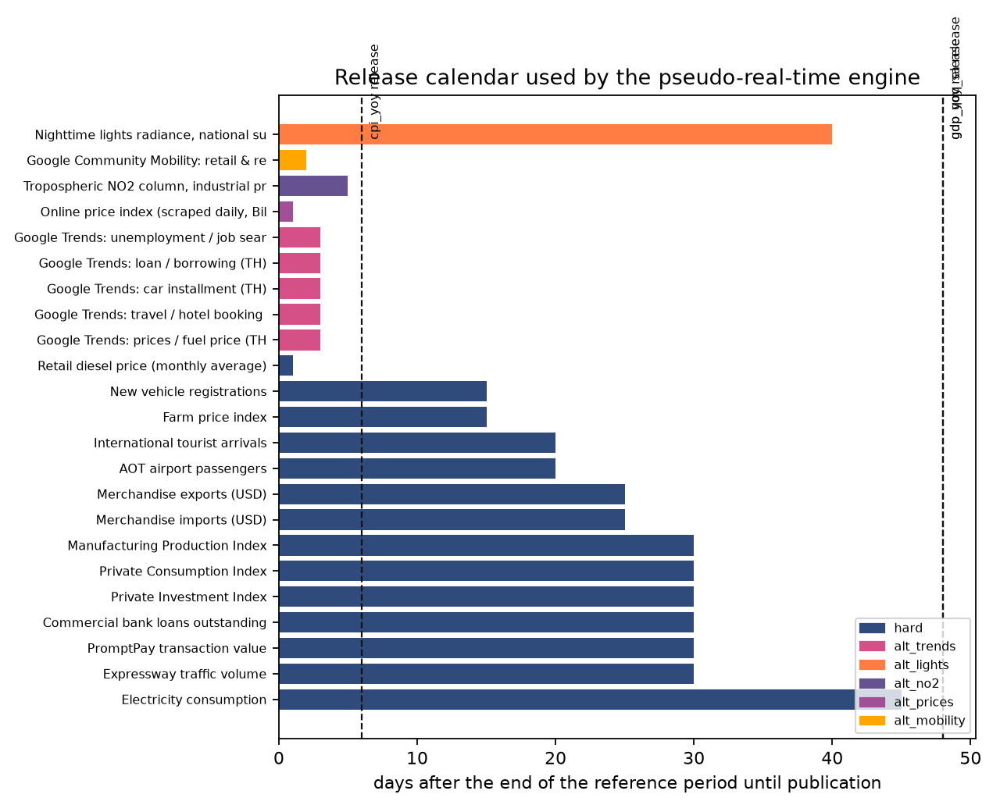
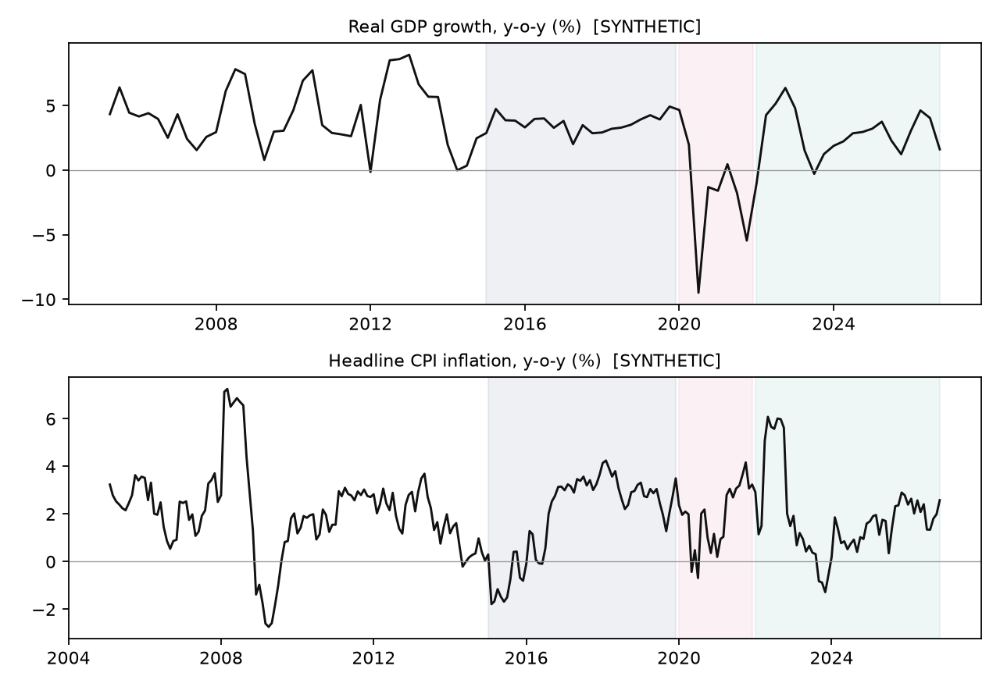
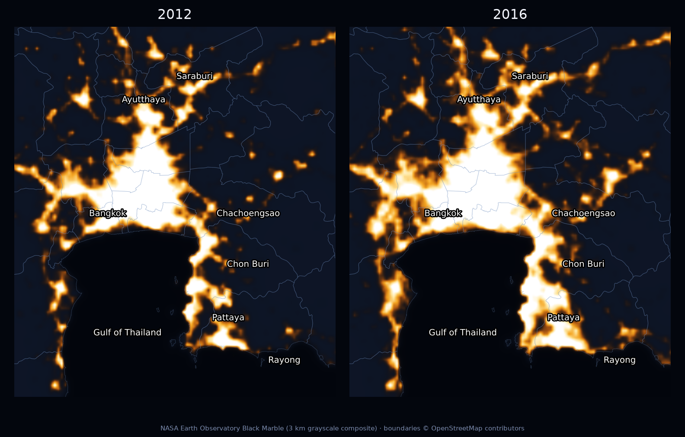
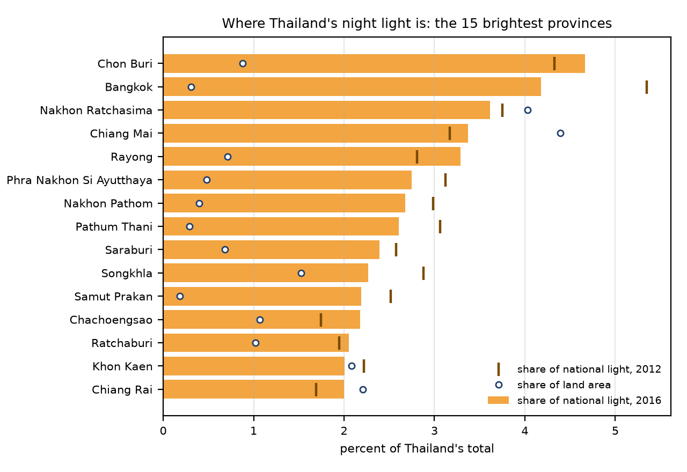
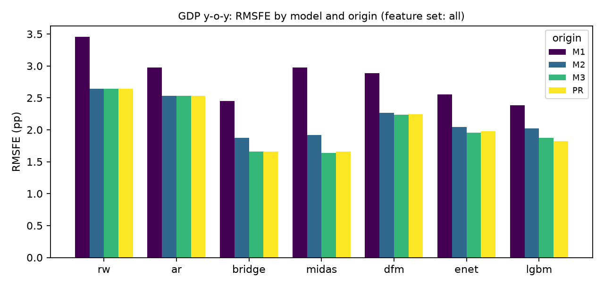
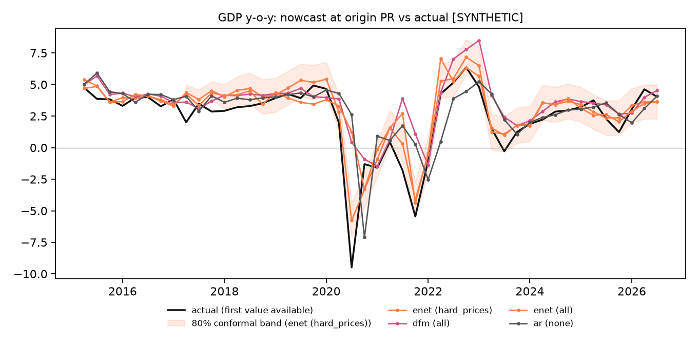
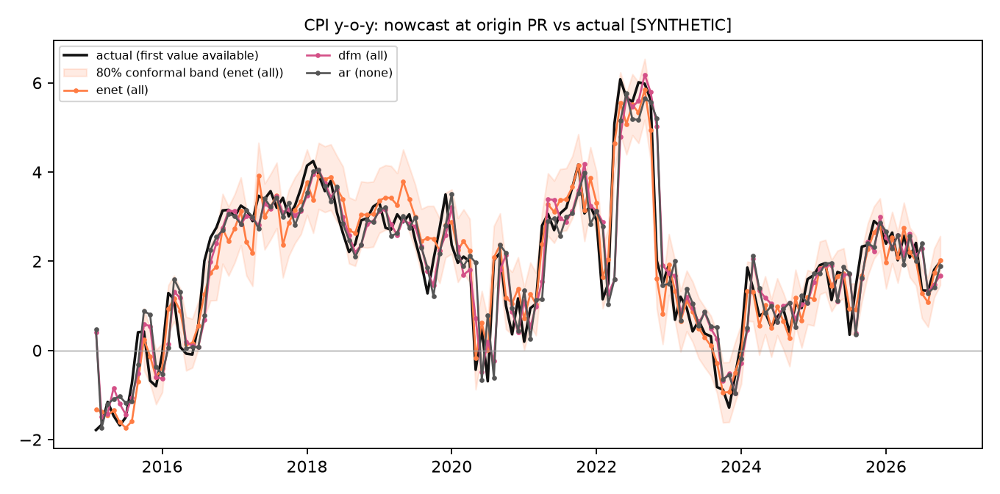
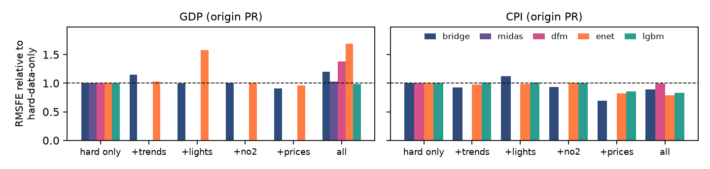
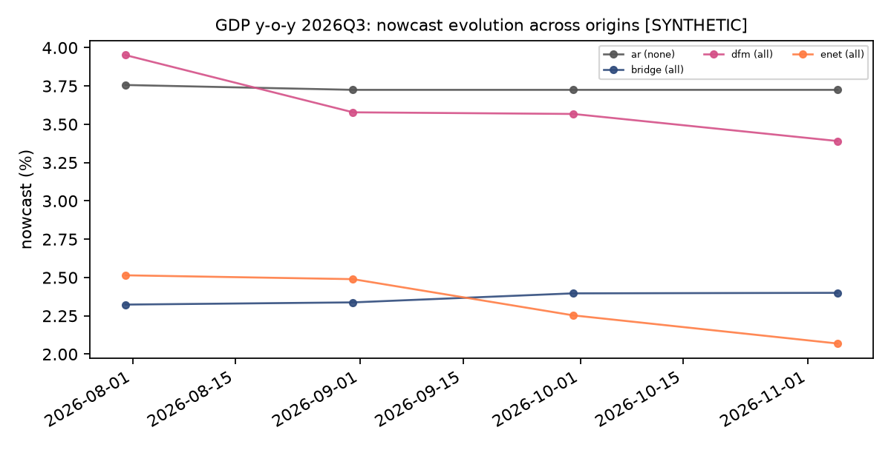
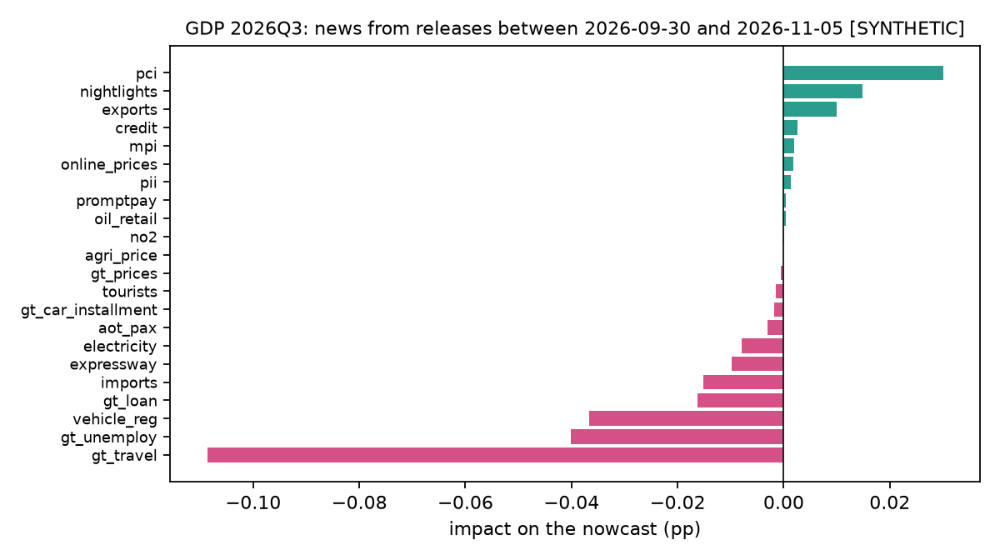

> **Status of this draft.** This is a {{synthetic_flag}}. All tables and figures were generated by the code in the accompanying repository from synthetic test data; the text describes what those tables show so that the reasoning can be checked, and should be rewritten once real data are in place.

# Introduction

Thailand's quarterly GDP arrives late. The National Economic and Social Development Council (NESDC) publishes the first estimate roughly 48 days after the end of the quarter, so for most of a quarter, and for a month and a half after it, policy makers, banks and firms work without an official reading of the economy's current state. Headline CPI is faster, about six days after the month ends, but monthly price shocks matter for monetary policy and wage bargaining, and the information needed to anticipate them, retail fuel prices, farm prices and online shelf prices, is available daily. Nowcasting, the use of higher-frequency and more timely indicators to estimate the current value of a low-frequency target before it is published, is the standard answer to this problem in central banks and statistical agencies [Giannone, Reichlin and Small, 2008; Bańbura et al., 2013].

Two things make nowcasting hard in practice and are easy to get wrong in a research project. The first is timing. A monthly indicator for March is not known in March; it is known when its agency publishes it, which for Thai manufacturing output is about a month later and for electricity consumption about six weeks later. An evaluation that aligns indicators by reference period instead of by publication date quietly uses the future and overstates accuracy. The second is the ragged edge: on any given day different indicators stop at different months, so a model must cope with a block of missing values at the end of the sample that changes shape every week.

This paper describes ThaiNowcast, a pipeline built around those two problems. Every observation is stored with its publication date; the information set at a nowcast origin is reconstructed by filtering on that date; a unit test fails if any model ever sees a value published after its origin. The ragged edge is handled either explicitly, by forecasting the missing months of each indicator before aggregating it (bridge, MIDAS, regularized regression, boosting), or natively, by a mixed-frequency dynamic factor model (DFM) whose expectation-maximization estimator treats missing values as part of the model [Bańbura and Modugno, 2014]. We then ask the applied question that motivates the exercise: do alternative data, in particular Thai-language Google Trends, satellite nighttime lights, satellite NO2 and scraped online prices, improve nowcasts over what official monthly statistics already deliver, and when?

The contribution is threefold. First, an open, tested, end-to-end pipeline for Thailand, from a registry of sources with their release lags to a static dashboard and this document, reproducible with one command. Second, an evaluation design that takes the data flow seriously: origins at the end of each month of the quarter and on the day before the official release, regime splits, Diebold-Mariano tests with a small-sample correction, conformal intervals calibrated on past nowcast errors, and a news decomposition of nowcast revisions. Third, an ablation that isolates the marginal value of each alternative data family rather than reporting "alternative data" as a block.

The environment in which this draft was produced could not reach the Thai statistical agencies, so the empirical sections run on a synthetic economy designed to have the same frequencies, start dates, publication lags, discontinuities and crisis episodes as the real data (Appendix A). We are explicit about this throughout. The synthetic results are informative about one thing only: whether the machinery behaves as theory predicts, for instance that accuracy improves as the quarter's data arrive, that the DFM can exploit short series that linear models must discard, and that intervals built from past errors are approximately calibrated. They say nothing about Thailand. Section 7 lists what changes when the real files are dropped into `data/raw/`.

# Related work

The modern nowcasting literature starts with Giannone, Reichlin and Small (2008), who formalized the idea of a daily-updated estimate of current-quarter GDP from a large panel of monthly releases using a dynamic factor model and the Kalman filter, and who introduced the "news" interpretation of nowcast revisions. Bańbura, Giannone, Modugno and Reichlin (2013) survey the approach and the real-time data flow; Bańbura and Modugno (2014) provide the EM algorithm for factor models with arbitrary patterns of missing data that underlies the statsmodels implementation we use. Mariano and Murasawa (2003) give the temporal aggregation constraint that links a quarterly growth rate to the monthly latent factor. Bridge equations (regressing the quarterly target on quarterly aggregates of monthly indicators that are first extended with univariate forecasts) are the workhorse of institutional nowcasting; the MIDAS regression of Ghysels, Santa-Clara and Valkanov (2004) avoids pre-aggregation by estimating a parsimonious weight polynomial on the monthly lags. Factor-augmented and diffusion-index regressions go back to Stock and Watson (2002).

Alternative data entered the literature with Choi and Varian (2012), who showed that Google Trends improves short-run forecasts of several economic series, and with Henderson, Storeygard and Weil (2012), who established nighttime lights as a proxy for economic activity where statistics are weak. Cavallo and Rigobon (2016) describe the Billion Prices Project, the scraped online-price approach to inflation measurement we imitate for CPI. Satellite tropospheric NO2 from Sentinel-5P has been used as a high-frequency industrial-activity indicator since the COVID-19 lockdowns. For Thailand specifically, the Bank of Thailand has published nowcasting work in its discussion-paper series; those references should be added once verified [VERIFY].

Machine learning entered nowcasting more recently, with regularized regressions (Tibshirani, 1996; Zou and Hastie, 2005) and gradient boosting (Ke et al., 2017) competing with factor models on panels of moderate size. Our design follows the consensus that these methods must be compared under identical pseudo-real-time information sets and that their gains tend to concentrate in turbulent periods. For prediction intervals we use split-conformal ideas (Vovk, Gammerman and Shafer, 2005; Angelopoulos and Bates, 2021) applied to past nowcast errors. For forecast comparison we use the Diebold and Mariano (1995) test with the Harvey, Leybourne and Newbold (1997) correction.

# Data and the release calendar

## Targets and indicators

Table 1 lists every series in the registry (`config/indicators.yaml`), with its source, group, frequency, sample, assumed publication lag and transformation. The two targets are real GDP growth year-on-year (NESDC) and headline CPI inflation year-on-year (Trade Policy and Strategy Office, Ministry of Commerce); the registry also carries seasonally adjusted quarter-on-quarter GDP growth as a secondary target, which can be run with `--targets gdp_qoq_sa`. We prefer the year-on-year rate as the primary GDP target because the NESDC's seasonal adjustment is revised more heavily than the unadjusted levels, which would contaminate a pseudo-real-time evaluation that lacks true vintages.

Hard data are fourteen official monthly series: the manufacturing production index (OIE), the Bank of Thailand's private consumption and private investment indices, bank credit and PromptPay transaction values, customs exports and imports, international tourist arrivals (MOTS), airport passengers (AOT), electricity consumption (EPPO), new vehicle registrations (DLT), expressway traffic (EXAT), retail diesel prices and the farm price index (OAE). Alternative data are five Thai-language Google Trends topics (unemployment and job search, loans, car installments, travel and hotel booking, prices and fuel), national VIIRS Black Marble nighttime radiance (VNP46A3, monthly, from April 2012), Sentinel-5P tropospheric NO2 over the industrial provinces (from July 2018), a scraped online price index (from 2015) and Google Community Mobility (retail and recreation, February 2020 to October 2022, discontinued). The alternative series are deliberately short and heterogeneous, as the real ones are; that is part of what the evaluation must cope with.

{{include:tables/tab_data_audit.md}}

Table: Data audit. Source and group as registered; lag is the assumed number of days between the end of the reference period and publication. Status marks whether the series loaded from a real file or from a synthetic substitute.

## Publication lags and the information set

Figure 1 shows the publication lags that drive the pseudo-real-time engine. Retail fuel prices, online prices, Google Trends and NO2 arrive within a week of the end of the month; customs trade and tourist arrivals within about three weeks; the BOT indices and the manufacturing index at the end of the following month; electricity consumption and nighttime lights six weeks later. GDP itself arrives 48 days after the quarter ends and CPI six days after the month ends. These lags are approximations taken from each agency's usual release timing and should be replaced by the exact dates from the agencies' calendars before a real evaluation (Section 7).



At an origin $t$, the information set $\Omega_t$ contains every observation whose publication date is at or before $t$, for the targets as well as the indicators. Two consequences follow that a reference-period alignment would miss. First, at the end of the first month of a quarter the previous quarter's GDP is not yet published (it arrives on day 48), so the autoregressive benchmark must forecast two steps ahead at that origin and one step at the later ones; the engine does this automatically because the benchmark sees only the released history. Second, at the end of a month none of the fast indicators for that month are available yet, since even a one-day lag places their release in the next month; the pre-release origin, one day before the official publication, is the first point at which the month's own fast data can be used. Figure 2 plots the two target series over the sample with the three evaluation regimes shaded.



## The geography of activity, seen from space

Figure 3 places the registry on the map. Most official indicators are national aggregates, but two inputs are defined over areas: the NO2 series averages the tropospheric column over the three provinces of the Eastern Economic Corridor (EEC) and Samut Prakan, where Thailand's heavy industry and its main deep-sea port are concentrated, and the nighttime-lights series sums radiance over all {{geo:n_provinces}} provinces.

![Thailand's provinces, with Bangkok, the Bangkok Metropolitan Region and the area over which the NO2 series is averaged. Boundaries: geoBoundaries ADM1 [Runfola et al., 2020], © OpenStreetMap contributors.](figures/fig_map_thailand.png){width=62%}

Nighttime lights are the most intuitive of the alternative data families, and Figure 4 shows why. It is the 2016 Black Marble composite built by NASA from the VIIRS day/night band on the Suomi NPP satellite [Román et al., 2018], and unlike the synthetic panel of the empirical sections it is real data. The image is a map of where economic activity takes place: the Bangkok Metropolitan Region and the Eastern Seaboard form one continuous glow, the regional centres of Chiang Mai, Udon Thani, Khon Kaen, Nakhon Ratchasima, Hat Yai and Phuket stand out as bright points, the main highways appear as strings of lit towns, and {{geo:dark_land_2016}} percent of the country's land is essentially dark (brightness below 10 on the image's 0 to 255 scale).

{width=74%}

Figure 5 zooms in on the centre of the country in 2012 and 2016. The lit area along the Eastern Seaboard and on the corridor from Bangkok through Ayutthaya to Saraburi appears wider in 2016, as one would expect over four years in which the EEC was being built up; part of the difference may, however, come from processing rather than from activity, and the two images should not be differenced into a growth rate.



Figure 6 puts numbers on the concentration. Summing image brightness within each province, the ten brightest provinces emit {{geo:share_top10_2016}} percent of the country's light; the six provinces of the Bangkok Metropolitan Region emit {{geo:share_bmr_2016}} percent from {{geo:area_bmr}} percent of the land, and the three EEC provinces {{geo:share_eec_2016}} percent from {{geo:area_eec}} percent. Bangkok itself appears smaller than it is ({{geo:share_bkk_2016}} percent from {{geo:area_bkk}} percent of the land) because {{geo:saturated_bkk_2016}} percent of its pixels sit at the top of the 8-bit scale: the display composite saturates in dense urban cores, a limitation that the calibrated radiance products (VNP46) reduce. This cross-sectional link between light and output is what motivates the use of lights in economics [Henderson, Storeygard and Weil, 2012]; the nowcasting models use its time-series counterpart, the monthly national radiance sum from VNP46A3, which in this draft is synthetic (Appendix A).

{width=88%}

The composites behind Figures 4 to 6 are images scaled for display, not calibrated radiance, so the shares describe where light is rather than how much; none of these figures enters a model.

# Methodology

## Transformations and the ragged edge

Indicators enter as year-on-year growth rates of their levels (log differences for the tourism and lights series, whose COVID-era collapses make ordinary percentage changes explode), as twelve-month differences for the bounded Google Trends indices, and as levels for mobility. A transformed value is available exactly when its latest input is, so transformation cannot leak.

Two routes handle the ragged edge. For the models that work at the target frequency (bridge, elastic net, boosting), each indicator is extended to the end of the target period with an AR(1) forecast fitted on its own history, provided the trailing gap is at most six months, and then averaged to quarters; a quarter counts only when all three months are present or filled. A column whose gap is longer, such as the discontinued mobility series after 2022, is unusable at that origin and is dropped. MIDAS anchors its lag window on the last available month and re-estimates its weights for each number of missing months. The DFM takes the monthly panel with its missing values as it is.

Linear models with many short regressors face a trade-off between breadth and history. We use one simple rule throughout: candidate columns are sorted by the start of their history and added in that order as long as at least 24 quarters (48 months) of complete training rows remain. A short alternative-data series therefore enters the linear models only once it has enough history, while the DFM can use it from the start. This asymmetry is one of the things the ablation measures.

## Models

Let $y_q$ be the quarterly target (or $y_m$ the monthly one) and $X_t$ the monthly indicator panel known at the origin.

*Random walk and AR(p).* The random walk repeats the last published value; the AR benchmark selects $p \le 4$ by AIC on the published history and forecasts the required number of steps. These are the benchmarks against which everything else is tested.

*Bridge equation with principal components.* The AR(1)-completed, quarterly-aggregated indicators are standardized, winsorized at four standard deviations and reduced to their first two principal components, which are regressed on the target by OLS. This is the classical institutional bridge model with a factor step to keep the regression parsimonious.

*MIDAS.* A single-regressor MIDAS with twelve monthly lags and exponential Almon weights, $y_q = \beta_0 + \beta_1 \sum_{j=0}^{11} w_j(\theta)\, x_{m(q)-\ell-j} + \varepsilon_q$, with $w_j(\theta) \propto \exp(\theta_1 j + \theta_2 j^2)$. The regressor $x$ is the cross-sectional mean of the standardized monthly indicators, a crude common factor that tolerates the ragged edge; $\ell$ is the number of months still missing in the target quarter, and the parameters are estimated by nonlinear least squares separately for each $\ell$.

*Mixed-frequency dynamic factor model.* One common factor following an AR(1), AR(1) idiosyncratic components, and the quarterly target linked to the monthly factor through the Mariano-Murasawa aggregation, estimated by EM on the standardized panel (statsmodels `DynamicFactorMQ`). The nowcast is the smoothed estimate of the target in the third month of the quarter (or in the target month for CPI, where the target enters the monthly panel). Parameters are re-estimated once a year and whenever the set of usable series changes; at every other origin the state is re-smoothed with the stored parameters. This mimics production practice and makes the news decomposition well defined.

*Elastic net.* Regularized regression on the same aggregated features as the bridge model, with the penalty mix chosen among $\{0.1, 0.5, 0.9\}$ and the penalty level by time-series cross-validation on the training window.

*LightGBM.* Gradient boosting with shallow trees (four leaves, 300 trees, learning rate 0.03, strong subsampling), a deliberately regularized configuration for a sample of a few dozen quarters. We expect it to overfit the quarterly target and include it to document that.

## Prediction intervals

For every model, feature set and origin we form an 80% interval as the point nowcast plus or minus the 80% quantile of the absolute errors of all target periods *already published* at that origin, for the same model and origin type. The quantile is thus computed from the past only; a nowcast made at the end of the first month of 2020Q2 uses the errors of periods whose actuals had been released by then. This is the split-conformal construction applied to a growing calibration set; its coverage should be close to nominal if errors are roughly exchangeable, and we report empirical coverage as a check.

## Evaluation design

The backtest is expanding-window pseudo-real-time from 2015Q1 (2015M1 for CPI) to the last period published at the information date. For each GDP quarter there are four origins: the end of each of its three months (M1, M2, M3) and the day before the NESDC release (PR). For each CPI month there are two: the end of the month (M0) and the day before the release (PR). Accuracy is summarized by the root mean squared forecast error (RMSFE) and the mean absolute error over the full sample and within three regimes, pre-COVID (2015 to 2019), COVID (2020 to 2021) and post-COVID (2022 onward). Each model is compared with the AR benchmark at the same origin with the Diebold-Mariano test on squared errors, using the Harvey-Leybourne-Newbold small-sample correction; with 46 quarterly observations the test has limited power, and we read it accordingly.

The ablation keeps the model fixed and varies the feature set: hard data only, hard data plus one alternative family at a time (Trends, lights, NO2, online prices), and everything together including mobility. The ratio of RMSFE to the hard-data-only RMSFE is the marginal value of that family. The bridge and elastic-net models run the full grid; MIDAS, LightGBM and the DFM run the two extremes.

## News decomposition

When new data arrive between two origins the DFM nowcast changes. With parameters held fixed, the change is a linear function of the forecast errors ("news") of the newly released observations, with weights given by the Kalman gain [Bańbura and Modugno, 2014]. We use the implementation in statsmodels to attribute the revision of the current-quarter nowcast between the end of the quarter and the information date to each releasing series. The decomposition is reported on the dashboard and in Section 5.5.

# Results

All numbers below are produced from synthetic data ({{synthetic_flag}}) and are read as a test of the pipeline's behaviour.

## GDP

Table 2 reports the RMSFE of every model at each origin for the hard-data-only and the all-data feature sets, with Diebold-Mariano stars against the AR benchmark at the same origin. Figure 7 shows the same information for the all-data set by origin, and Figure 8 plots the nowcasts at the pre-release origin against the actuals with the conformal band of the best model.

{{include:tables/tab_rmsfe_gdp_yoy.md}}

Table: GDP growth (y-o-y, pp): RMSFE by model, feature set and origin, full backtest sample. Stars mark Diebold-Mariano rejections of equal squared-error loss against AR at the same origin (* 10%, ** 5%, *** 1%). Random walk and AR use no indicators.





Three features of the table are what a working pipeline should produce. First, accuracy improves monotonically as the quarter's data arrive: for every indicator model the RMSFE at the pre-release origin is below that at the end of the first month, whereas the benchmarks improve only when the previous quarter's GDP is published. The pre-release origin adds little beyond the end of the third month in the synthetic economy because its indicators are persistent enough for the AR(1) completion of the final month to be accurate; on real data, where the third month often carries the news, the gap should be larger. Second, the best indicator model at the pre-release origin is {{best:gdp_yoy:label}}, with an RMSFE of {{best:gdp_yoy:rmsfe}} pp against {{rmsfe:gdp_yoy:ar:none:PR}} for the AR benchmark, a ratio of {{best:gdp_yoy:rel}}. Third, the gains are not uniform over time. Table 3 splits the pre-release RMSFE by regime for the all-data set: before COVID the synthetic economy is close to its trend and the autoregressive benchmark is hard to beat (AR {{regime:gdp_yoy:ar:none:PR:pre_covid}} versus bridge {{regime:gdp_yoy:bridge:all:PR:pre_covid}} and DFM {{regime:gdp_yoy:dfm:all:PR:pre_covid}}); during the COVID quarters the benchmark error explodes to {{regime:gdp_yoy:ar:none:PR:covid}} pp while the indicator models stay between {{regime:gdp_yoy:midas:all:PR:covid}} (MIDAS) and {{regime:gdp_yoy:dfm:all:PR:covid}} (DFM); after COVID the elastic net reaches {{regime:gdp_yoy:enet:all:PR:post_covid}} against {{regime:gdp_yoy:ar:none:PR:post_covid}}. This is the pattern the nowcasting literature reports on real data, where the value of timely indicators is concentrated in turning points, and it is reassuring that the engine reproduces it from a data-generating process in which the indicators load on the same factor as GDP.

{{include:tables/tab_regime_gdp_yoy.md}}

Table: GDP growth: RMSFE at the pre-release origin by regime, all-data feature set (benchmarks use no indicators).

LightGBM behaves as expected for a sample of this size: competitive during the COVID quarters and after, where a few extreme observations dominate the squared loss and a piecewise fit pays, but the weakest indicator model before COVID ({{regime:gdp_yoy:lgbm:all:PR:pre_covid}} against {{regime:gdp_yoy:bridge:all:PR:pre_covid}} for the bridge equation), where the signal is small and smooth. The DFM is not the most accurate model in the synthetic race, which is not surprising when the true data-generating process is a one-factor model whose aggregated principal components are an almost sufficient statistic; its advantages, native handling of missing data and the news decomposition, show up in the ablation and in Section 5.5 rather than in the headline RMSFE.

## CPI

Table 4 reports the monthly results. The autoregressive benchmark is strong for inflation, whose year-on-year rate is persistent, and at the end-of-month origin none of the indicator models beats it, for the mechanical reason noted in Section 3.2: at that origin the fast indicators for the month itself are not yet published and their AR(1) extrapolation adds nothing beyond what the target's own history contains. The pre-release origin, five days later, is where the fast data matter. There the elastic net with all data reaches an RMSFE of {{rmsfe:cpi_yoy:enet:all:PR}} pp against {{rmsfe:cpi_yoy:ar:none:PR}} for the benchmark, LightGBM {{rmsfe:cpi_yoy:lgbm:all:PR}} and the DFM {{rmsfe:cpi_yoy:dfm:all:PR}}; with hard data only the elastic net is at {{rmsfe:cpi_yoy:enet:hard_only:PR}}, so about half of its gain comes from the fast official series (retail fuel, farm prices) and the rest from the alternative data, mostly the online price index, which in the synthetic economy tracks the month's inflation innovation by construction. The bridge model is inadequate for a monthly target (its principal components discard the one or two series that carry the signal), which the Diebold-Mariano test flags at any conventional level; the DFM, the elastic net and LightGBM are the relevant comparison. Unlike GDP, the CPI gains are present in every regime (Table 5), because the fast price data are informative in calm months as well as in 2022. Figure 9 plots the CPI nowcasts.

{{include:tables/tab_rmsfe_cpi_yoy.md}}

Table: Headline CPI inflation (y-o-y, pp): RMSFE by model, feature set and origin, with Diebold-Mariano stars against AR at the same origin.

{{include:tables/tab_regime_cpi_yoy.md}}

Table: CPI inflation: RMSFE at the pre-release origin by regime, all-data feature set.



## The marginal value of each alternative data family

Tables 6 and 7 and Figure 10 report the ablation: the RMSFE of each model with hard data plus one alternative family, relative to the same model on hard data only, at the pre-release origin.

{{include:tables/tab_ablation_gdp_yoy.md}}

Table: GDP growth: RMSFE at the pre-release origin by feature set, and ratio to the hard-data-only RMSFE for the same model.

{{include:tables/tab_ablation_cpi_yoy.md}}

Table: CPI inflation: RMSFE at the pre-release origin by feature set, and ratio to the hard-data-only RMSFE for the same model.



The synthetic ablation illustrates a result that is easy to forget when "alternative data" is treated as a block: adding a noisy or short series to a linear model can hurt. In the synthetic economy the Google Trends topics load on the common factor but carry their own COVID-era level shifts and much idiosyncratic noise, and the lights series starts only in 2013; under the history-for-breadth rule, switching them on shortens the training window or adds regressors with little signal, and the bridge and elastic-net RMSFE ratios rise above one for those families (bridge with Trends {{abl:gdp_yoy:bridge:hard_trends}}, elastic net with lights {{abl:gdp_yoy:enet:hard_lights}}). The online price index, which by construction tracks the target's price process, is the one family that helps the GDP bridge model ({{abl:gdp_yoy:bridge:hard_prices}}) and, as the CPI panel shows, the one that pays for inflation: relative RMSFE {{abl:cpi_yoy:enet:hard_prices}} for the elastic net and {{abl:cpi_yoy:lgbm:hard_prices}} for LightGBM, with the full set at {{abl:cpi_yoy:enet:all}} and {{abl:cpi_yoy:lgbm:all}}, while lights, NO2 and Trends leave the CPI models essentially unchanged. The DFM, which does not need balanced panels, is affected differently: its all-data ratio is {{abl:gdp_yoy:dfm:all}}, driven by the level shifts in the mobility and tourism-related series during 2020 to 2021 that a one-factor model must absorb into the factor. None of these magnitudes transfer to Thailand; the point of the exercise is that the pipeline resolves the marginal value of each family separately and that the answer can be negative, so that the real-data run can discard families that do not pay for themselves.

## Interval calibration

Tables 8 and 9 report the empirical coverage and average width of the 80% conformal intervals at the pre-release origin. Coverage should be close to 0.80 if past nowcast errors are representative of future ones; departures below nominal are expected across a regime change, since the calibration set at the start of 2020 contained only calm years.

{{include:tables/tab_coverage_gdp_yoy.md}}

Table: GDP growth: empirical coverage and mean width (pp) of 80% conformal intervals at the pre-release origin.

{{include:tables/tab_coverage_cpi_yoy.md}}

Table: CPI inflation: empirical coverage and mean width (pp) of 80% conformal intervals at the pre-release origin.

Coverage for the GDP models lies between {{covmin:gdp_yoy}} and {{covmax:gdp_yoy}} at the pre-release origin and for the CPI models between {{covmin:cpi_yoy}} and {{covmax:cpi_yoy}}, with the undercoverage concentrated in 2020 as expected. The intervals of the indicator models are narrower than the benchmark's where the models are more accurate, which is the property one wants from a calibrated band: the width reflects the model's own past errors, not a fixed multiple of a residual variance.

## The current nowcast and its news

At the information date, {{asof}}, the first unpublished GDP quarter is {{live:gdp_yoy:period}} and the first unpublished CPI month is {{live:cpi_yoy:period}}. Table 10 lists the nowcast of every model with its 80% band; the headline model is the one with the lowest full-sample RMSFE at the pre-release origin. The headline GDP nowcast is {{live:gdp_yoy:value}} percent ({{live:gdp_yoy:lo}} to {{live:gdp_yoy:hi}}) from {{live:gdp_yoy:model}}, and the headline CPI nowcast is {{live:cpi_yoy:value}} percent ({{live:cpi_yoy:lo}} to {{live:cpi_yoy:hi}}) from {{live:cpi_yoy:model}}.

{{include:tables/tab_live.md}}

Table: Nowcasts at the information date with 80% conformal bands, by model and feature set.



Figure 11 traces the GDP nowcast of the core models across the four origins, from the end of the quarter's first month to the information date, with the headline model's band. Figure 12 and Table 11 decompose the change in the all-data DFM nowcast between the end of the quarter and the information date into the contribution of each series that published a new observation in between: with the parameters fixed, the revision is the weighted sum of the surprises in those releases, and the weights are the Kalman gains the model assigns to each series. In the synthetic run the decomposition sums to the observed revision to within rounding, which is the check that matters for the implementation; the sign and size of each bar are properties of the synthetic loadings.



{{include:tables/tab_news_gdp.md}}

Table: News decomposition: contribution of each series' new releases to the revision of the all-data DFM nowcast, pp.

# Robustness

Several choices in the pipeline are defaults rather than findings, and each is exposed as a parameter so that the real-data run can vary it.

*History-for-breadth rule.* The 24-quarter (48-month) minimum training window determines when a short alternative series enters the linear models. A looser rule admits series earlier at the cost of fewer training rows; a stricter rule approaches the hard-data-only result. The DFM provides the limiting case in which every series is used from its first observation.

*Refit frequency.* The DFM is re-estimated annually; re-estimating at every origin is roughly ten times slower and, in the synthetic run, changes nowcasts by less than the width of the intervals (it can be enabled with `DFM(refit="origin")`). The MIDAS weights and the regularization path of the elastic net are re-estimated at every origin.

*Factor count and lag order.* The synthetic economy has one factor, so one factor is correct by construction; the real data will need the usual information-criterion check (Bai and Ng, 2002) and at least a two-factor comparison, since Thai activity has a distinct external-demand component (exports, tourism) and a domestic one.

*Seeds.* The synthetic results depend on the random seed of the generator. We report one seed; `make synthetic --seed N` followed by `make eval` reproduces the tables for another, and the pattern of findings (monotone improvement across origins, gains concentrated in the COVID regime, mixed marginal value of noisy families) held across the seeds we tried while developing the code. A systematic multi-seed study is a one-line loop and is left for the real-data stage, where it is not needed.

*Loss function.* All comparisons use squared error. The MAE columns in the stored summaries tell the same story in the synthetic run; on real data the COVID quarters will dominate the squared loss and MAE is the more honest headline.

# Limitations

*The data are synthetic.* This is the overriding limitation of the present draft. The synthetic economy was built to stress the machinery, not to resemble Thailand's business cycle beyond the timing of its crises and the size of a few headline numbers. Every quantitative statement in Section 5 should be re-derived from the real files; the text is written so that the reasoning survives that replacement, but the conclusions may not.

*No real-time vintages.* Even with real data the evaluation is pseudo-real-time: final values with reconstructed publication dates, rather than the values that were actually published on each date. For GDP, revisions are material and systematically related to the cycle, so an evaluation on final data overstates the accuracy of every model including the benchmark. The remedy is to collect the first-release value from each NESDC press release since 2015 (about 45 documents), store it as the "actual" for scoring, and keep the final series for estimation; the data layer already supports a per-observation publication date and only needs a vintage column.

*Approximate release calendar.* The publication lags are typical values. Agencies occasionally publish early or late, and some change their calendars; the exact dates should be scraped or entered by hand. The error from this approximation is small for slow series and matters for the fast ones around the pre-release origin.

*Short samples and test power.* Forty-six quarterly observations, eight of them in the COVID regime, give the Diebold-Mariano test little power and make the regime split fragile; the monthly CPI evaluation, with 141 observations, is more informative statistically and is where machine learning methods have room to show an advantage.

*Alternative data quality.* Google Trends indices are rescaled per query and drift when the comparison baseline changes; nighttime lights need careful cloud and lunar corrections; scraped prices need a stable basket and attention to terms of service; NO2 reflects weather as much as activity. The pipeline treats them as given; a real-data study must document each construction.

*Model coverage.* The race omits several standard entries: a Bayesian VAR, a factor-augmented MIDAS, a nonlinear DFM, and forecast combinations. The last is the most useful addition for a production system and can be computed from the stored backtest table without re-estimation.

# Conclusion

ThaiNowcast turns a familiar research design into a tested, reproducible artifact: a registry of Thai official and alternative data with publication lags, an information-set engine that cannot leak, a race of standard and machine-learning nowcasting models that handle the ragged edge in different ways, an evaluation at several origins and across regimes with significance tests and calibrated intervals, an ablation of each alternative data family, and a news decomposition that explains every revision. On a synthetic economy with the real data's timing and missingness the pipeline behaves as the theory says it should: accuracy improves as the period's data arrive, the value of indicators is concentrated in turning points, noisy or short series can hurt linear models while the factor model absorbs them, and intervals built from past errors are approximately calibrated.

The next step is the one the environment of this draft could not take: downloading the real files (`docs/data_sources.md` lists each one with its source), collecting first-release GDP values from the NESDC press releases, replacing the assumed lags with actual release dates, and running `make all`. Every table, figure and number in this document, including the current-quarter nowcast on the dashboard, will then describe Thailand rather than the pipeline.

# References {-}

```{=latex}
\begingroup\small\setlength{\parindent}{-1.5em}\setlength{\leftskip}{1.5em}\setlength{\parskip}{0.3em}
```

Angelopoulos, A. N., and Bates, S. (2021). A gentle introduction to conformal prediction and distribution-free uncertainty quantification. arXiv:2107.07511.

Bai, J., and Ng, S. (2002). Determining the number of factors in approximate factor models. *Econometrica*, 70(1), 191–221.

Bańbura, M., Giannone, D., Modugno, M., and Reichlin, L. (2013). Now-casting and the real-time data flow. In *Handbook of Economic Forecasting*, Vol. 2A, 195–237. Elsevier.

Bańbura, M., and Modugno, M. (2014). Maximum likelihood estimation of factor models on datasets with arbitrary pattern of missing data. *Journal of Applied Econometrics*, 29(1), 133–160.

Cavallo, A., and Rigobon, R. (2016). The Billion Prices Project: Using online prices for measurement and research. *Journal of Economic Perspectives*, 30(2), 151–178.

Choi, H., and Varian, H. (2012). Predicting the present with Google Trends. *Economic Record*, 88(s1), 2–9.

Diebold, F. X., and Mariano, R. S. (1995). Comparing predictive accuracy. *Journal of Business & Economic Statistics*, 13(3), 253–263.

Ghysels, E., Santa-Clara, P., and Valkanov, R. (2004). The MIDAS touch: Mixed data sampling regression models. CIRANO Working Paper 2004s-20.

Giannone, D., Reichlin, L., and Small, D. (2008). Nowcasting: The real-time informational content of macroeconomic data. *Journal of Monetary Economics*, 55(4), 665–676.

Harvey, D., Leybourne, S., and Newbold, P. (1997). Testing the equality of prediction mean squared errors. *International Journal of Forecasting*, 13(2), 281–291.

Henderson, J. V., Storeygard, A., and Weil, D. N. (2012). Measuring economic growth from outer space. *American Economic Review*, 102(2), 994–1028.

Ke, G., et al. (2017). LightGBM: A highly efficient gradient boosting decision tree. *Advances in Neural Information Processing Systems 30 (NIPS 2017)*.

Mariano, R. S., and Murasawa, Y. (2003). A new coincident index of business cycles based on monthly and quarterly series. *Journal of Applied Econometrics*, 18(4), 427–443.

NASA Earth Observatory (2017). Earth at Night: Black Marble 2012 and 2016 grayscale maps (3 km). Image records 144896 and 144897. Public domain.

Román, M. O., Wang, Z., Sun, Q., Kalb, V., et al. (2018). NASA's Black Marble nighttime lights product suite. *Remote Sensing of Environment*, 210, 113–143.

Runfola, D., Anderson, A., Baier, H., Crittenden, M., et al. (2020). geoBoundaries: A global database of political administrative boundaries. *PLOS ONE*, 15(4), e0231866.

Stock, J. H., and Watson, M. W. (2002). Macroeconomic forecasting using diffusion indexes. *Journal of Business & Economic Statistics*, 20(2), 147–162.

Tibshirani, R. (1996). Regression shrinkage and selection via the lasso. *Journal of the Royal Statistical Society B*, 58(1), 267–288.

Vovk, V., Gammerman, A., and Shafer, G. (2005). *Algorithmic Learning in a Random World*. Springer.

Zou, H., and Hastie, T. (2005). Regularization and variable selection via the elastic net. *Journal of the Royal Statistical Society B*, 67(2), 301–320.

```{=latex}
\par\endgroup
```

# Appendix A: the synthetic economy {-}

The generator (`thainowcast.data.synthetic`) draws a monthly common factor $f_t$ as an AR(1) with coefficient 0.85 and innovation standard deviation 0.7, and adds event shocks where Thai history had them: the global financial crisis (October 2008 to September 2009, with a rebound in 2010), the floods of late 2011 (with a rebound in 2012), the political crisis of early 2014, COVID-19 (a trough of $-15$ in April 2020, the Delta wave in the third quarter of 2021, a recovery through 2022). Trend growth is 4.3 percent until 2012, 3.2 percent from 2013 to 2019, 3.0 percent during 2020 to 2021 and 2.4 percent after. Quarterly GDP growth is the trend plus 1.1 times the quarterly mean of the factor plus Gaussian noise with standard deviation 0.5; quarter-on-quarter growth is 0.75 plus 0.9 times the change in the quarterly factor plus noise. Monthly CPI inflation is $1.2 + 0.08\,\text{oil}_t + 0.12\,\text{agri}_t + c_t + 0.08 f_{t-6} + \varepsilon_t$, where oil and farm price growth are persistent processes with the 2008, 2015, 2020 and 2022 episodes imposed and $c_t$ is a slow core component.

Each indicator's growth rate is $a_i + \lambda_i f_{t-d_i} + \text{extra}_{i,t} + u_{i,t}$ with an AR(1) idiosyncratic term; levels are rebuilt from the growth rates with a seasonal pattern so that the pipeline's own transformations are exercised. Tourism and airport passengers are multiplied by a COVID collapse-and-recovery path (to 1 percent and 15 percent of baseline respectively); the Google Trends indices are bounded levels with their own COVID level shifts; nighttime lights start in April 2012, NO2 in July 2018, PromptPay in 2016, online prices in 2015, mobility runs from February 2020 to October 2022 only. The generator writes `synthetic_*.csv` files and a manifest with the seed; the loader uses them only when the real file is absent and announces every substitution.

# Appendix B: reproducibility {-}

```
git clone https://github.com/thanatchon36/thainowcast && cd thainowcast
make setup          # uv venv + dependencies
make data           # loads data/raw (real where present, synthetic_* otherwise)
make eval           # backtest, DM tests, intervals, ablations, tables, figures
make live           # nowcast of the current quarter / month + news
make dashboard      # dashboard/index.html
make paper          # paper/paper.tex and paper/paper.pdf (pandoc + tectonic)
make arxiv          # paper/arxiv.tar.gz, the arXiv source bundle
make test           # 27 tests incl. the leakage test
```

Every table in this document is an included file in `paper/tables/`, every figure a file in `paper/figures/`, and every number in the text a placeholder resolved at build time from `data/processed/`; none is typed by hand.
